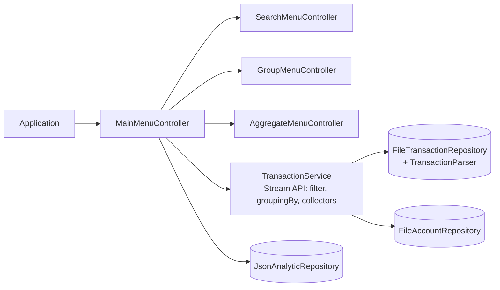
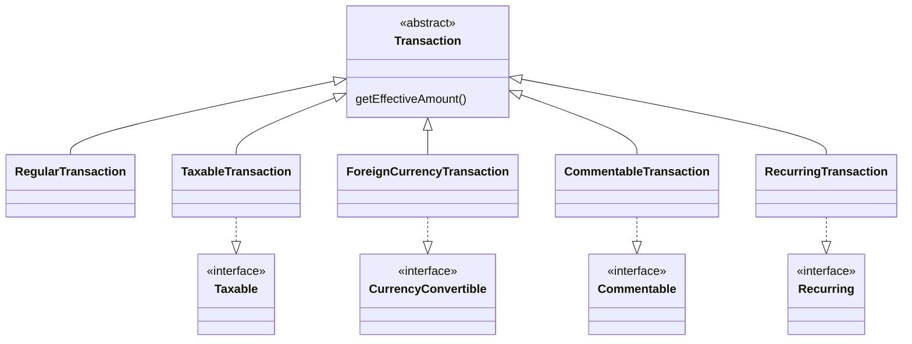

# Fin Tracker

A console application for analysing bank transactions stored in text files: filter, group and aggregate them, then save
the result as JSON. The interactive menu is in Russian (the original course assignment language); the code, tests and
documentation are in English.

Final project of the Skillbox "Advanced Java Core" course. Built solo.

## Features

- reads accounts and transactions from text files, with clear parse errors that name the offending line
- five transaction types, each with its own rule for the "effective" amount:
  | Type | Extra field | Effective amount |
  |---|---|---|
  | `Regular` | none | the amount |
  | `Taxable` | tax rate | amount minus tax |
  | `ForeignCurrency` | exchange rate | amount converted to the base currency |
  | `Commentable` | comments separated by `;` | the amount; comments are searchable |
  | `Recurrent` | `pattern;repeat count` (`hourly` ... `yearly`) | the amount; every repeat counts in date searches |
- three account types: checking, savings, credit
- **search** by category, date range, amount range and comment (filters can be combined)
- **group** by month, year, day of week, category, account type, user ID, or income vs expense
- **aggregate**: sum, average, count (money is `BigDecimal`, rounded half-up to 2 decimals)
- results are printed and can be appended to a JSON file

## Architecture





| Package (`com.skillbox`) | Responsibility |
|---|---|
| `controller` | console menus, reading and validating user input |
| `service` | filtering, grouping and aggregation with the Stream API |
| `data.model` | accounts, the transaction hierarchy and its interfaces, analytics result |
| `data.repository` | text-file readers, the line parser, the JSON writer |
| `exception` | custom exceptions (`DataParseException`, `DataReadException`, ...) |

## Input files

`accounts.txt`: `account id, account type, user id` where the type is `0` checking, `1` savings, `2` credit.

`transactions.txt`: `account id, transaction id, ISO date-time, category, amount, type, extra field`.

Lines starting with `#` and text after `#` are ignored, and blank lines are skipped. Ready-made samples that cover all
five transaction types are in [`examples/`](examples).

## Run it

Needs Java 17 or newer. The Gradle wrapper downloads Gradle itself.

```bash
./gradlew run --args="examples/accounts.txt examples/transactions.txt analytics.json" --console=plain
```

Arguments: accounts file, transactions file, output JSON file. On Windows use `gradlew.bat`.

### Scripted demo (no typing)

```bash
./gradlew run --args="examples/accounts.txt examples/transactions.txt analytics.json" --console=plain < examples/demo-input.txt
```

`examples/demo-input.txt` presses the menu keys for you: total per year, number of transactions per category, save to
`analytics.json`, exit. Expected key lines in the output: `2023: 3736.90`, `2024: 15.75`, `Food: 2`.

### Interactive demo

Main menu: `1` search criteria, `2` grouping, `3` aggregation, `4` calculate and print, `5` save, `0` exit. Try this:
`2` then `2` (group by year), `4` (calculate), then `1` then `2` and `Food` (category filter), `0`, `4` again.

## Tests

```bash
./gradlew test
```

Unit tests cover the line parser (every transaction type and every kind of malformed line), the effective-amount rules,
recurring-transaction dates, the file readers, the JSON writer, every grouping and aggregation of the service, all
filters, and the console menu driven through simulated keystrokes. They run without any files from the repository.
GitHub Actions runs the tests and the scripted demo on every push and pull request.

## Tech stack

Java 17, Gradle, Jackson (JSON and `jsr310`), JUnit 5, AssertJ, GitHub Actions.
